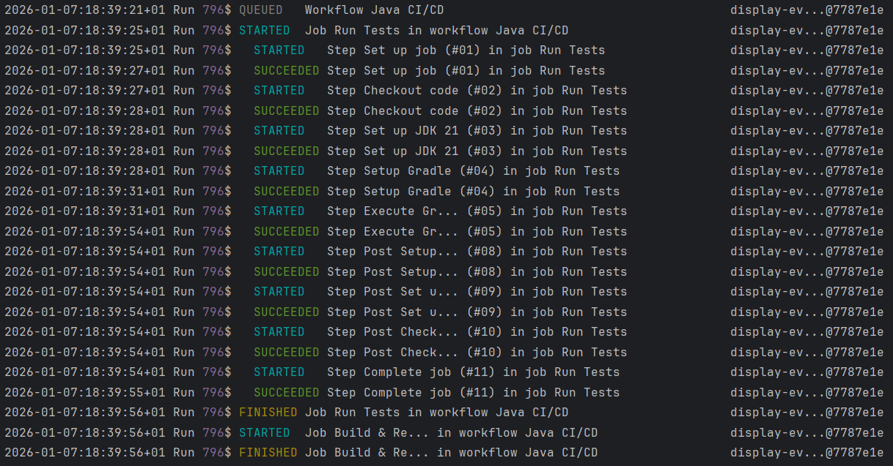

# ghwork



Command-line tool for monitoring GitHub Actions workflow runs in real time. Queries the GitHub REST API to track workflow execution state and displays domain events as they occur.

## Table of Contents

- [Overview](#overview)
- [Verification](#verification)
  - [Fault Injection](#fault-injection)
  - [Property-based Testing](#property-based-testing)
  - [Running the Tests](#running-the-tests)
  - [Continuous Integration](#continuous-integration)
- [Codebase](#codebase)
  - [Architecture Highlights](#architecture-highlights)
  - [Project Structure](#project-structure)
  - [Dependencies](#dependencies)
- [Installation](#installation)

## Overview

ghwork is a Java 21 CLI application that monitors GitHub Actions workflow runs for a specified repository. The application polls the GitHub REST API at regular intervals, compares workflow state between requests using a diffing algorithm, and outputs domain events representing state transitions.

The application maintains persistent state across executions using Java object serialization. State is stored in platform-specific application data directories. The tool tracks workflow runs, jobs, and job steps, detecting transitions such as workflow queuing, job start and completion, and step execution outcomes.

The main execution loop enforces a minimum request interval of 5 seconds between API calls to prevent the GitHub API limit from being exceeded. The application handles multiple repositories by maintaining separate state mappings for each repository.

Domain events are generated by comparing previous state snapshots with current API responses. Events are sorted chronologically and formatted for terminal output using ANSI color codes.

## Verification

### Fault Injection

The tests in `GhworkApplicationTests` run the whole application against a simulated GitHub API, provided by [WireMock](https://wiremock.org/). The simulated API is configured to fail in controlled ways, so that the error handling of the application can be checked. The tested failures include:

- Error status codes, such as `401`, `404`, `429` and `503`, from both the workflow runs and the jobs endpoints
- Dropped connections, empty responses, and responses that are not valid JSON
- Slow responses, connection timeouts, refused connections, and unknown hosts
- Untrusted TLS certificates

For each case, the tests check whether the application retries the request or stops with a clear error message. They also check that the application recovers once the API responds normally again.

The issues found and fixed through these tests are listed in [FAULT_INJECTION.md](FAULT_INJECTION.md).

### Property-based Testing

The tests in `DiffingServiceProperties` use [jqwik](https://jqwik.net/) to generate workflow runs, jobs and steps, and check the rules of the `DiffingService`.

Using randomized inputs was able to expose bugs that the few manual tests were not able to show.

Below is a list of the checked properties:
- Comparing a state with itself produces no events.
- Comparing a state with the same runs in a different order produces no events.
- Events are sorted by timestamp, then by type.
- Each state transition between the two snapshots produces exactly one event, and no other events are produced.
- Comparing state A with B and then B with C produces the same events as comparing A with C directly.
- The same event is never reported twice.

The issues found and fixed through these tests are listed in [PROPERTY_BASED_TESTING.md](PROPERTY_BASED_TESTING.md).

### Running the Tests

To run the full test suite:
```bash
./gradlew test
```

To check that the source code follows the Checkstyle rules:
```bash
./gradlew checkstyleMain
```

As an alternative to the commands above, the recipes in the `Justfile` can be run with [just](https://github.com/casey/just). They require a Unix-compatible shell (for example, Git Bash or WSL on Windows):

| Command           | Equivalent                               |
|-------------------|------------------------------------------|
| `just test`       | `./gradlew test`                         |
| `just checkstyle` | `./gradlew checkstyleMain`               |
| `just build`      | `./gradlew build`                        |
| `just dist`       | `./gradlew installDist`                  |

### Continuous Integration

A GitHub Actions workflow (`.github/workflows/main.yml`) runs on every push. It sets up Java 21, runs the Checkstyle check, and runs the test suite. The workflow fails if either step fails.

On the `main` branch, the workflow also builds the distribution, packages it as a ZIP file, and publishes it as a GitHub release tagged with the project version.

## Codebase

### Architecture Highlights

The application follows a layered architecture with clear separation between API communication, domain logic, and presentation concerns.

**State Management:**
State persistence uses Java object serialization to a single file per application instance. The storage location is determined by operating system conventions: Windows uses `%APPDATA%`, macOS uses `~/Library/Application Support`, and Linux uses `$XDG_CONFIG_HOME` or `~/.config`. The serialized data structure is a `Map<Repository, ToolState>` where each repository maintains its own workflow run tracking state.

**API Communication:**
The HTTP clients use the `java.net.http` package. Error handling maps HTTP status codes to domain exceptions: 401 for invalid tokens, 404 for non-existent repositories, 4xx for client errors, and 5xx for server errors. Network errors and invalid JSON responses are mapped to their own exceptions. Each exception states whether the failed request can be retried.

Job data fetching uses parallel requests via `CompletableFuture` to reduce latency when querying multiple workflow runs. All requests are synchronized using `CompletableFuture.allOf()` before processing responses.

**Event Generation:**
The diffing algorithm compares workflow run states at two points in time. For each workflow run, it compares run-level status transitions, then iterates through jobs and steps to detect state changes. Status values are mapped to ordered enumeration types to determine valid transitions.

Events are generated only for forward progress through state machines. Completed workflows, jobs, and steps are not re-evaluated. The algorithm ensures the after-state is a superset of the before-state by fetching additional data for runs that disappeared from the API response.

**Output Formatting:**
Terminal output uses ANSI escape codes for colorization. Run IDs are displayed with deterministic color assignment based on hash values. Text truncation and padding ensure consistent line lengths of 120 characters. Timestamps are formatted using `DateTimeFormatter` with ISO-like patterns.

**Rate Limiting and Retries:**
The main loop enforces a minimum interval between API calls (5 seconds by default). The application calculates sleep duration based on the time elapsed since the last request to maintain consistent polling frequency.

Temporary failures (status codes 408, 429, 500, 502, 503 and 504, network errors, and invalid JSON) are retried. After each consecutive failure, the wait time is multiplied by a constant factor (exponential backoff). The application stops after too many consecutive failures. The interval, timeouts, retry limit and backoff factor are set in `src/main/resources/application.properties`.

**Dependency Injection:**
Services and factories are created and connected by a Spring IoC container, configured in `AppConfig`.

**Logging:**
Warnings and errors are logged with Log4j 2, configured in `src/main/resources/log4j2.xml`.

**Error Recovery:**
Malformed serialized state files are automatically deleted and recreated. The application handles `ClassNotFoundException` and `ClassCastException` during deserialization by resetting to an empty state map.

### Project Structure

The codebase is organized into six main packages:

**`api`** - GitHub REST API client implementations
- `GithubClient` - Abstract base class for HTTP client operations with authentication and error handling
- `WorkflowClient` - Fetches all workflow run data from a repo from the `/actions/runs` endpoint
- `JobClient` - Fetches job data from `/actions/runs/{run_id}/jobs` endpoints using parallel requests
- `WorkflowService` - Orchestrates API calls and maps workflow runs to their associated jobs
- `WorkflowClientFactory`, `JobClientFactory`, `WorkflowServiceFactory` - Factories that build the clients to ensure their repository and access token fields are final
- `WorkflowResponse`, `JobResponse` - Data transfer objects for API responses
- `exceptions` - Exception hierarchy for API errors, indicating which errors can be retried

**`cli`** - Command-line interface components
- `ArgumentParser` - Validates and parses command-line arguments (repository and access token)
- `CliArguments` - Value object containing parsed arguments
- `CliPrinter` - Formats domain events for terminal output with ANSI color codes and padding
- `StorageService` - Manages persistent state using Java object serialization with platform-specific storage paths
- `EnvService` - Reads configuration values from `application.properties`
- `exceptions` - Custom exception hierarchy for CLI error handling
- `runcount` - Specifies whether the polling loop runs indefinitely or a fixed number of times

**`domain`** - Core domain models and events
- `Repository` - Value object representing a GitHub repository identifier
- `AccessToken` - Value object for GitHub personal access token
- `WorkflowRun` - Workflow execution state including status, conclusion, and timestamps
- `WorkflowRunData` - Container for workflow run and associated jobs
- `Job` - Job execution state with steps
- `JobStep` - Individual step execution state
- `ToolState` - Persistent state container mapping runs and ignored run IDs
- `events` - Domain event hierarchy including `WorkflowQueuedEvent`, `JobStartedEvent`, `JobFinishedEvent`, `StepStartedEvent`, `StepSucceededEvent`, `StepFailedEvent`

**`diffing`** - State comparison and event generation
- `DiffingService` - Computes differences between state snapshots and generates domain events
- `WorkflowRunStatus`, `JobStatus`, `StepStatus` - Status enumeration types for state ordering

**`json`** - JSON deserialization utilities
- `JsonService` - Parses JSON responses using Gson with custom deserializers
- `InstantDeserializer` - Custom Gson deserializer from ISO-8601 timestamp strings into `Instant` objects

**`ioc`** - Dependency injection configuration
- `AppConfig` - Spring configuration that defines the `Gson` and `HttpClient` beans and scans for components

**`test`** - Unit, end-to-end, fault injection and property-based tests, mirroring the main package structure

### Dependencies

The project uses Gradle for dependency management with version catalogs defined in `gradle/libs.versions.toml`.

**Runtime Dependencies:**
- `com.google.code.gson:gson:2.13.2` - JSON deserialization for GitHub API responses
- `org.fusesource.jansi:jansi:2.4.3` - ANSI terminal colors library for simpler logic
- `org.springframework:spring-context:7.0.9` - Spring IoC container for dependency injection
- `org.apache.logging.log4j:log4j-api:2.26.1`, `org.apache.logging.log4j:log4j-core:2.26.1` - Logging

**Test Dependencies:**
- `org.junit.jupiter:junit-jupiter:6.0.1` - JUnit 6 testing framework
- `org.junit.platform:junit-platform-launcher:6.0.1` - Test execution platform
- `org.wiremock:wiremock:3.13.2` - Simulated HTTP server for fault injection tests
- `net.jqwik:jqwik:1.10.2` - Property-based testing library
- `org.apache.logging.log4j:log4j-core-test:2.26.1` - Captures log output in tests

**Build Plugins:**
- Checkstyle 13.7.0 - Code style checks

The application uses Java 21 with the application plugin configured. The main class is `com.ghwork.GhworkApplication`.

## Installation

**Prerequisites:**
- Java 21 or later
- Gradle 8.0 or later (included via Gradle Wrapper)

**Build from Source:**
```bash
./gradlew build
```

The build also runs the Checkstyle check and the test suite.

**Create Distribution:**
```bash
./gradlew installDist
```

The distribution will be created in `build/install/ghwork/` containing executable scripts and JAR dependencies.

If just is installed, `just build` and `just dist` can be used instead (see [Running the Tests](#running-the-tests)).

**Run the Application:**
```bash
./build/install/ghwork/bin/ghwork <owner/repo> <access_token>
```

Replace `<owner/repo>` with the GitHub repository identifier in the format `owner/repository-name`. Replace `<access_token>` with a GitHub personal access token with `actions:read` permission.

The application runs continuously until interrupted. Press Ctrl+C to exit. State is automatically persisted between executions.